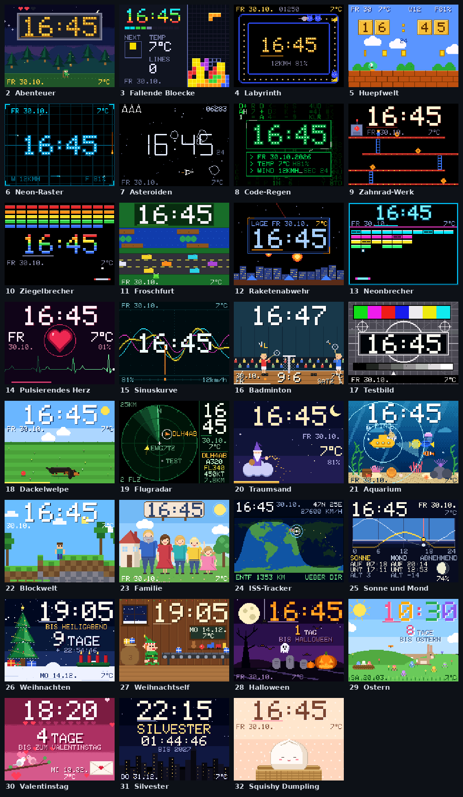
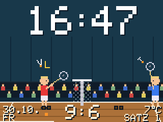
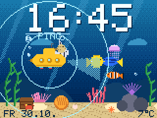
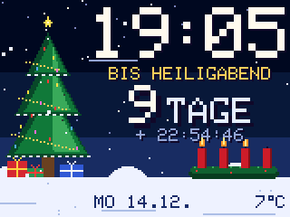
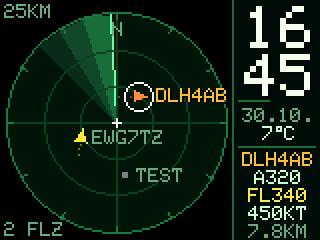
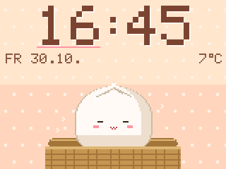
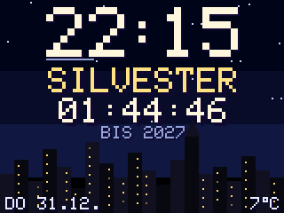

# RetroTV-Wecker 2,0 Zoll

Eine kleine WLAN-Uhr mit Wetter, Wecker und **33 Zifferblättern** im Pixel-Retro-Stil – auf einem
2,0-Zoll-Farbdisplay (320 × 240) mit einem ESP32-C3 SuperMini. Alles wird bequem im Browser eingestellt,
neue Firmware kommt per WLAN.



*Alle Bilder sind echte Bildschirm-Ausgaben der Firmware (am PC gerendert, 2× vergrößert).*

---

## Was die Uhr kann

- **Uhrzeit** per Internet (NTP) mit automatischer Sommer-/Winterzeit oder **von Hand** eingestellt.
- **Wetter** von [Open-Meteo](https://open-meteo.com) (kostenlos, ohne Konto): Temperatur, Feuchte, Wind, Vorhersage.
- **33 Designs**: 2 klassische Uhren (Flip-Karten, Digital mit Sekundenbalken) und 31 animierte Szenen –
  Arcade-Spiele, Tiere, Technik, Himmel und Weltraum, Feiertage.
- **Automatischer Design-Wechsel** nach Zeitplan durch eine selbst gewählte Liste.
- **Feiertage mit Countdown**: Weihnachten (mit Adventskranz), Weihnachtself, Halloween, Ostern (echtes Osterdatum),
  Valentinstag, Silvester. An Silvester schaltet die Uhr von 23:30 bis 00:30 von selbst auf **Feuerwerk**.
- **Echte Daten live**: Flugradar mit Flugzeugen in der Umgebung (offene ADS-B-Dienste), ISS-Tracker mit der echten
  Position der Raumstation, Sonne und Mond für deinen Standort.
- **Kleine Überraschungen**: ab und zu ein UFO im Flugradar, im Dezember der Weihnachtsschlitten statt der ISS,
  im Aquarium Besuch von einer Seeschlange oder einem U-Boot.
- **Laufschrift** mit eigenem Text (Umlaute und Sonderzeichen).
- **Helligkeit und Nachtmodus**: Dimmen nach Zeitplan, nachts optional das TV-Testbild.
- **Wecker und Stundensignal** mit einem aktiven Piezo-Summer (optional).
- **Touch-Taster** (optional): durch die Designs blättern, Laufschrift starten, Standby.
- **Firmware-Update über WLAN** direkt im Browser.

## Ein paar Designs im Detail

| Badminton | Aquarium | Weihnachten |
|---|---|---|
|  |  |  |
| Match über drei Sätze bis 21 nach echten Regeln: Smash mit Geschwindigkeit, Hawk-Eye, Satz- und Matchball, jubelndes Publikum. Der Spielstand bleibt auch nach Stromausfall erhalten. | Korallenriff mit Lichtmustern, Clownfischen in der Anemone, Neon-Schwarm, Qualle, Schatztruhe – und ab und zu Besuch. | Countdown bis Heiligabend 18 Uhr, Adventskranz mit einer Kerze mehr an jedem Adventssonntag, Schneefall. |

| Flugradar | Squishy Dumpling | Silvester |
|---|---|---|
|  |  |  |
| Echte Flugzeuge rund um deinen Standort mit Rufzeichen, Typ, Höhe und Geschwindigkeit. | Ein knautschiger Teigknödel im Dämpfkorb: hüpft, wabbelt, wird mit Stäbchen angestupst und schläft nachts. | Countdown bis Neujahr, in der letzten Minute riesige Sekunden, um Mitternacht Dauerfeuerwerk. |

Die vollständige Liste aller Designs mit Beschreibung steht in der
[ausführlichen Anleitung](firmware/WetterUhr/README.md#uhr-designs-und-farben).

---

## Hardware

| Teil | Hinweis |
|---|---|
| ESP32-C3 SuperMini | Mikrocontroller mit WLAN, USB-C |
| 2,0-Zoll-TFT GMT020-02-7P | ST7789, 240 × 320, SPI (Pins: CS, DC, RST, SDA, SCL, VCC, GND) |
| Touch-Taster TTP223 | optional |
| Aktiver Piezo-Summer 3 V + NPN-Transistor (z. B. BC547) + 1 kΩ | optional, für Wecker und Stundensignal |

### Verdrahtung

| Bauteil | Anschluss | ESP32-C3 SuperMini |
|---|---|---|
| Display | SCL | GPIO 4 |
| Display | SDA | GPIO 6 |
| Display | CS | GPIO 7 |
| Display | DC | GPIO 3 |
| Display | RST | GPIO 1 |
| Display | VCC / GND | 3V3 / GND |
| Touch-Taster TTP223 | I/O (VCC an 3V3, GND an GND) | GPIO 5 |
| Summer (über NPN) | GPIO → 1 kΩ → Basis; Emitter an GND; Kollektor an Summer „−“; Summer „+“ an 3V3 | GPIO 10 |

GPIO 2, 8 und 9 bitte frei lassen (Boot-Pins). Alle Pins lassen sich in
[`config.h`](firmware/WetterUhr/config.h) ändern.

---

## Schnellstart

### 1. Arduino IDE einrichten (einmalig)

1. **Boardpaket**: Unter *Datei → Einstellungen → Zusätzliche Boardverwalter-URLs*
   `https://espressif.github.io/arduino-esp32/package_esp32_index.json` eintragen, dann im Boardverwalter
   **esp32 by Espressif Systems** installieren.
2. **Bibliotheken** (Bibliotheksverwalter): *Adafruit GFX Library*, *Adafruit ST7735 and ST7789 Library*,
   *ArduinoJson* (Version 7).
3. **Board-Einstellungen** unter *Werkzeuge*:
   - Board: **ESP32C3 Dev Module**
   - USB CDC On Boot: **Enabled**
   - Partition Scheme: **Minimal SPIFFS (1.9MB APP with OTA)** – wichtig für Updates per WLAN

### 2. Firmware aufspielen (einmalig per USB)

**Ohne Arduino IDE (am einfachsten):** Im Ordner [`releases/`](releases) die Datei
`WetterUhr_<Version>_erstinstallation.bin` herunterladen, in Chrome oder Edge
<https://espressif.github.io/esptool-js/> öffnen, ESP32-C3 per USB verbinden (**Connect**), *Flash Address* `0x0`,
Datei wählen, **Program**. Genaue Schritte stehen in der `LIESMICH.md` der jeweiligen Version.
Dabei werden vorhandene Einstellungen gelöscht.

**Mit der Arduino IDE:** Ordner [`firmware/WetterUhr`](firmware/WetterUhr) herunterladen (oder das Quellcode-Zip aus
[`releases/`](releases)), `WetterUhr.ino` in der Arduino IDE öffnen und per USB hochladen.

### 3. Einrichten im Browser

1. Ohne gespeichertes WLAN öffnet die Uhr den Access-Point **Wetteruhr-Setup** (Passwort `wetteruhr1`).
2. Mit Handy oder PC verbinden und `http://192.168.4.1` öffnen.
3. WLAN, Zeitzone und Standort eintragen, speichern – die Uhr startet neu.
4. Danach ist sie unter ihrer IP-Adresse (kurz auf dem Display eingeblendet) oder `http://wetteruhr.local` erreichbar.
5. **Bitte ein Web-Passwort setzen** (System → Zugang).

---

## Updates über WLAN

Jede neue Version liegt im Ordner [**`releases/`**](releases) in drei Formen
(aktuell: [`releases/2026.10.30`](releases/2026.10.30)):

| Datei | Wofür |
|---|---|
| `WetterUhr_<Version>_erstinstallation.bin` | komplette Firmware für die Erstinstallation per USB (an Adresse `0x0`) |
| `WetterUhr_<Version>_update.bin` | Update-Datei zum Einspielen über WLAN |
| `WetterUhr_<Version>_komplett.zip` | kompletter Quellcode für die Arduino IDE |

**Update einspielen:** Browser → *System* → *Firmware-Update über WLAN* → `.bin` wählen → *Update installieren*.
Browser und Display zeigen den Fortschritt. Die Uhr prüft die Datei und startet nur bei Erfolg neu; sonst läuft
die alte Firmware weiter. Alle Einstellungen bleiben erhalten. Unter *Status → Firmware* steht danach die neue Version.

Alternativ in der Arduino IDE unter *Werkzeuge → Port* den Netzwerk-Port **wetteruhr** wählen und normal hochladen.

> **Umstieg von einer älteren Version:** Lief die Uhr bisher mit dem Partitionsschema *Huge APP (No OTA)*,
> muss die neue Version **einmal per USB** installiert werden – entweder mit der `…_erstinstallation.bin`
> (Einstellungen werden gelöscht) oder aus der Arduino IDE mit *Minimal SPIFFS (1.9MB APP with OTA)*
> (Einstellungen bleiben). Danach gehen alle Updates per WLAN.

Was sich in jeder Version geändert hat, steht im [CHANGELOG](firmware/WetterUhr/CHANGELOG.md).

---

## Bedienung im Browser

| Seite | Inhalt |
|---|---|
| Status | WLAN, IP, Uhrzeit, Wetter, aktuelles Design, Dimmung, Wecker, Firmware-Version |
| Anzeige | Designs mit Vorschaubildern, Akzentfarbe, automatischer Wechsel, Extras (Silvester-Automatik, Weihnachtsschlitten, UFO, Aquarium) |
| Helligkeit | Helligkeit, Standby, Zeitplan-Dimmung, Nachtmodus mit Testbild |
| Laufschrift | Text, Position, Größe, Farbe, Tempo, Dauerschleife |
| Summer & Wecker | Stundensignal, Nachtruhe, Weckzeit mit Wochentagen, Summer-Test |
| WLAN | Netzwerk suchen und eintragen |
| Zeit & Wetter | Zeitzone, NTP oder manuelle Uhrzeit, Standort, Wetter-Intervall, Flugradar-Radius |
| System | Gerätename, Web-Passwort, Firmware-Update über WLAN, Werkseinstellungen |

Alle Einzelheiten – Designs, Dimmung, Wecker, Touch-Bedienung, Fehlersuche – stehen in der
**[ausführlichen Anleitung](firmware/WetterUhr/README.md)**.

---

## Projektaufbau

```
firmware/WetterUhr/        Arduino-Sketch (diesen Ordner in der Arduino IDE öffnen)
  WetterUhr.ino            Hauptprogramm: Anzeige, WLAN, Wetter, Flugradar, ISS, Update
  config.h                 Pins, Standardwerte, Firmware-Version
  settings.h               Einstellungen im Flash
  webui.h                  Einstellungsseite im Browser
  faces.h, faces_*.h       Rahmen für die Themen-Designs (160×120-Pixelpuffer, 2× vergrößert)
  face_*.h                 je ein Design
  ticker.h, buzzer.h       Laufschrift, Summer und Wecker
  README.md                ausführliche Anleitung
  CHANGELOG.md             Änderungen je Version
docs/images/               Bilder für diese Seite
releases/<Version>/        Erstinstallations-.bin, Update-.bin und Quellcode-Zip je Version
```

## Technik in Kürze

- Die Themen-Designs zeichnen in einen 160 × 120-Pixelpuffer mit 256 Farben, der auf 320 × 240 verdoppelt wird.
  Gesendet werden nur geänderte Kacheln – das ergibt flüssige Animationen ohne Flackern.
- Wetter, Flugradar und ISS werden in eigenen Hintergrund-Tasks geholt; die Anzeige blockiert nie.
- Der ESP32-C3 hat keine Gleitkomma-Einheit – rechenintensive Effekte (Wasser, Lichtmuster) nutzen Ganzzahl-Tabellen.
- Gebaut mit dem ESP32-Arduino-Core 3.3.x; die Firmware belegt rund 1,65 MB.

## Hinweise

- Die Einstellungsseite läuft über unverschlüsseltes HTTP im eigenen WLAN. Ohne Web-Passwort kann jeder im
  Netzwerk die Uhr bedienen und Firmware einspielen.
- Flugdaten: adsb.lol, airplanes.live, adsb.fi – nur für private, nicht kommerzielle Nutzung. ISS-Daten: open-notify.org.
  Wetter: Open-Meteo.
- Alle Figuren und Szenen sind eigene Gestaltungen im Retro-Stil.
