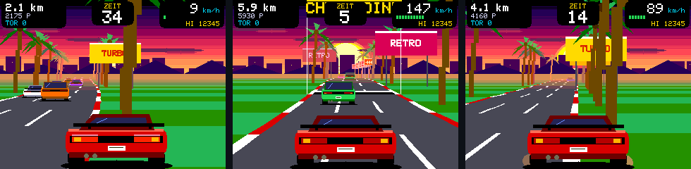

**RetroCYD 3.3** – die Spiele für den RetroTV-Wecker auf dem CYD 2,8 Zoll. Die Uhr selbst bleibt bei Version **2026.11.09**.

### Neu in RetroCYD 3.3
- **Sunset Race überarbeitet:**
  - eigenes Auto deutlich größer und detaillierter (Heckflügel, Rückleuchten mit Bremslicht, Kennzeichen, Auspuff mit Flammen bei Vollgas, Schatten, Neigung in Kurven, Staub neben der Straße)
  - alle Autos im selben Maßstab; Gegner in sechs Farben, auch Kleinbusse
  - Strecke mit **Hügeln** und weichen Kurven, Dunst in der Ferne, drei Fahrspuren mit Markierungen
  - Himmel mit feinerem Verlauf, gestreifte Sonne, Wolken, Stadtsilhouette und Berge
  - Palmen, Kurvenschilder mit Pfeilen, Plakatwände; **Tore** an den Checkpoints
  - Startampel 3-2-1, Anzeigen mit Tempobalken, Zahl der Tore
  - bergauf langsamer, bergab schneller
- **Entfernt:** Jungle Raid, Dojo Duel, Maze Bot (jetzt 13 Spiele).

### Dateien
| Datei | Wofür |
|---|---|
| `RetroCYD_3.3_update.bin` | Spiele aktualisieren: im Browser der **Uhr** unter *System → Firmware-Update* einspielen |
| `WetterUhr_2026.11.09_RetroCYD_3.3_CYD_mitSpielen_erstinstallation.bin` | neues CYD: Uhr 2026.11.09 + RetroCYD 3.3 per USB an `0x0` (löscht Einstellungen) |
| `RetroCYD_3.3_komplett.zip` | Quellcode RetroCYD (Boardpaket *esp32_bluepad32*, Bibliothek *LovyanGFX*) |

Die Uhr-Dateien (Update, nur Uhr, ESP32-C3) stehen im Release **v2026.11.09**.

### Build
Boardpaket *esp32_bluepad32* 4.1, LovyanGFX, *ESP32 Dev Module*, *Minimal SPIFFS (1.9MB APP with OTA)*, 1,43 MB (72 %).

_Dieses Release wurde automatisch aus dem Ordner `releases/2026.11.09-2` erstellt._
