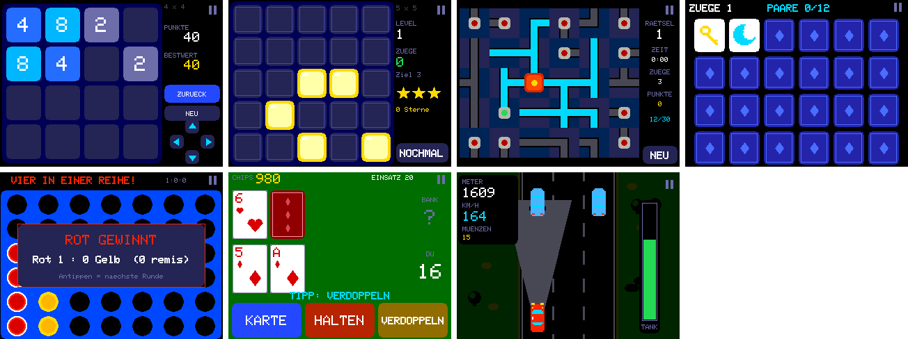

**RetroCYD 3.7** – Spiele nach Kategorien und sieben neue Spiele für den Touchscreen (CYD 2,8 Zoll).
Die Uhr bleibt bei **2026.11.10** (siehe Release [v2026.11.10](https://github.com/smo0601-collab/RetroTVWecker-2.0-Zoll/releases/tag/v2026.11.10)).

### Neu
- **Menü mit Kategorien:** KLASSIKER, SHOOTER, JUMP & RUN, RENNEN, DENKSPIELE, BRETT & KARTEN. Kategorie antippen
  zeigt ihre Spiele; „< ZURÜCK“, die Kopfzeile oder B führen zurück.
- **Sieben neue Spiele**, direkt per Touch bedienbar (mit Controller über einen Auswahlrahmen):
  - **2048** – wischen oder Pfeilfelder; ein Zug zurück, 4 × 4 und 5 × 5, das laufende Spiel wird gespeichert, Schiebeanimation.
  - **Lichter aus** – 5 × 5, 6 × 6 und drei Farben; Level immer lösbar, Sterne nach Zahl der Züge, Fortschritt gespeichert.
  - **Rohrpost** – Rohre drehen; jedes Rätsel ist ein zufälliger Spannbaum (unbegrenzt, immer lösbar), 6 × 5 und 8 × 6, Zeitwertung.
  - **Paare finden** – 1 Spieler, auf Zeit (90 s), 2 Spieler abwechselnd; Symbolsätze FORMEN und ZAHLEN zum Freischalten.
  - **Vier gewinnt** – CPU mit Suchtiefe 4, 6 oder 8, 2 Spieler, „Fünf gewinnt“ auf 9 × 7; Fallanimation, Gewinnreihe blinkt, Serienwertung.
  - **Siebzehn und vier** – Karte, Halten, Verdoppeln, Teilen; Chips und Statistik gespeichert, Trainer zeigt den besten Zug.
  - **Spurwechsel** – Rennen von oben auf drei Spuren; Tank und Kanister, Münzen, Autos kaufen, Nachtfahrt mit Scheinwerfern,
    Motorton über den Lautsprecher-Anschluss (im Startbildschirm einschaltbar).
- Ecke oben rechts (Pause-Zeichen) öffnet in allen Touch-Spielen das Menü.

### Einspielen
Im Browser der Uhr: *System → Firmware-Update* → `RetroCYD_3.7_update.bin`. Highscores, WLAN und Einstellungen bleiben erhalten.

Alternativ: `WetterUhr_2026.11.10_RetroCYD_3.7_CYD_mitSpielen_erstinstallation.bin` per USB an `0x0` (löscht Einstellungen).

### Dateien
| Datei | Wofür |
|---|---|
| `RetroCYD_3.7_update.bin` | CYD: Spiele-Update (im Browser der Uhr) |
| `WetterUhr_2026.11.10_RetroCYD_3.7_CYD_mitSpielen_erstinstallation.bin` | CYD: Uhr 2026.11.10 + RetroCYD 3.7 per USB an `0x0` |
| `RetroCYD_3.7_komplett.zip` | Quellcode RetroCYD |
