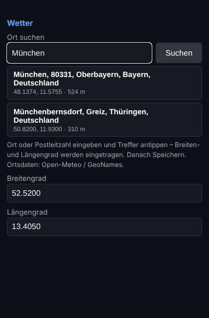

**Firmware 2026.11.10** – Ortssuche für den Standort.

### Neu
- Im Reiter **Wetter** gibt es über Breiten- und Längengrad das Feld **„Ort suchen“**: Ort oder Postleitzahl eingeben,
  *Suchen* (oder Enter), Treffer antippen – Breiten- und Längengrad werden eingetragen. Danach **Speichern**.
- Die Treffer zeigen Name, PLZ, Kreis/Region, Land, Koordinaten und Höhe, damit gleichnamige Orte unterscheidbar sind.
- Daten von der Ortssuche von Open-Meteo (derselbe Dienst wie das Wetter, kein Schlüssel nötig), in der eingestellten
  Sprache. Der Browser fragt direkt, falls das nicht klappt, fragt die Uhr selbst.
- Die Suche braucht Internet. Im Einrichtungs-WLAN der Uhr (ohne Internet) die Koordinaten weiter von Hand eintragen.

### Einspielen
Im Browser der Uhr: *System → Firmware-Update* → `WetterUhr_2026.11.10_CYD_update.bin` (CYD) bzw.
`WetterUhr_2026.11.10_update.bin` (ESP32-C3). RetroCYD bleibt bei 3.6 (keine Änderung).

### Dateien
| Datei | Wofür |
|---|---|
| `WetterUhr_2026.11.10_CYD_update.bin` | CYD: Uhr-Update |
| `WetterUhr_2026.11.10_CYD_mitSpielen_erstinstallation.bin` | CYD: Uhr + RetroCYD 3.6 per USB an `0x0` |
| `WetterUhr_2026.11.10_CYD_erstinstallation.bin` | CYD: nur Uhr per USB an `0x0` |
| `WetterUhr_2026.11.10_update.bin` / `_erstinstallation.bin` | ESP32-C3 |
| `RetroCYD_3.6_update.bin`, `RetroCYD_3.6_komplett.zip` | Spiele (unverändert) |
| `WetterUhr_2026.11.10_komplett.zip` | Quellcode der Uhr |

Alle Änderungen: [CHANGELOG](https://github.com/smo0601-collab/RetroTVWecker-2.0-Zoll/blob/main/firmware/WetterUhr/CHANGELOG.md)
