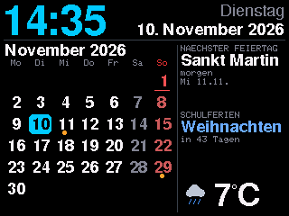

**Firmware 2026.11.11** – Kalender mit Feiertagen, besonderen Tagen und Schulferien für jedes Bundesland.

### Neu
- **Reiter „Kalender“ im Browser:** Bundesland wählen; gesetzliche Feiertage, besondere Tage, Schulferien,
  Einblendung und Laufschrift einzeln an/aus; Jahresübersicht mit 12 Monatsblättern und Liste;
  jede Einblendung lässt sich 20 Sekunden lang ansehen.
- **Gesetzliche Feiertage je Bundesland** – in der Uhr berechnet, funktioniert auch ohne Internet.
- **Besondere Tage:** Valentinstag, Weiberfastnacht, Rosenmontag, Faschingsdienstag, Muttertag, Vatertag, Erntedank,
  Halloween, Sankt Martin, Nikolaus, 1.–4. Advent, Heiligabend, Silvester, Ferienbeginn, letzter Schultag.
- **Schulferien** von openholidaysapi.org (frei, ohne Schlüssel), in der Uhr gespeichert, wöchentlich erneuert.
- **Lustige Einblendung am Feiertag:** alle 15 Minuten (einstellbar, 7–22 Uhr) 20 Sekunden lang ein eigenes animiertes
  Bild mit Uhrzeit – z. B. Luther mit Hammer, Bollerwagen zum Vatertag, Schere gegen Krawatte an Weiberfastnacht,
  Adventskranz mit der richtigen Zahl Kerzen – dazu ein passender Spruch als Laufschrift.
- **Laufschrift-Countdown:** „Morgen ist Sankt Martin“, „Noch 12 Tage bis zu den Herbstferien“, „Herbstferien: noch 4 Tage frei!“
- **Design 28 „Kalender“:** Monatsblatt mit Feiertagen (rot), besonderen Tagen (Punkt) und Ferien (blau), daneben
  heute / demnächst / Schulferien und das Wetter.

### Einrichten
Browser → **Kalender** → Bundesland wählen → *Speichern*. Die Schulferien erscheinen kurz danach (Internet nötig).
Das Monatsblatt: *Anzeige → Design → Kalender* (oder in den Design-Wechsel aufnehmen).

### Einspielen
Im Browser der Uhr: *System → Firmware-Update* → `WetterUhr_2026.11.11_CYD_update.bin` (CYD) bzw.
`WetterUhr_2026.11.11_update.bin` (ESP32-C3). RetroCYD bleibt bei 3.8.1.

### Dateien
| Datei | Wofür |
|---|---|
| `WetterUhr_2026.11.11_CYD_update.bin` | CYD: Uhr-Update |
| `WetterUhr_2026.11.11_CYD_mitSpielen_erstinstallation.bin` | CYD: Uhr + RetroCYD 3.8.1 per USB an `0x0` |
| `WetterUhr_2026.11.11_CYD_erstinstallation.bin` | CYD: nur Uhr per USB an `0x0` |
| `WetterUhr_2026.11.11_update.bin` / `_erstinstallation.bin` | ESP32-C3 |
| `RetroCYD_3.8.1_update.bin`, `RetroCYD_3.8.1_komplett.zip` | Spiele (unverändert) |
| `WetterUhr_2026.11.11_komplett.zip` | Quellcode der Uhr |

Alle Änderungen: [CHANGELOG](https://github.com/smo0601-collab/RetroTVWecker-2.0-Zoll/blob/main/firmware/WetterUhr/CHANGELOG.md)
